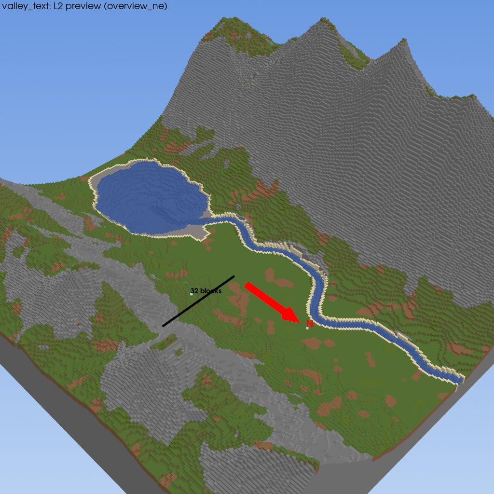
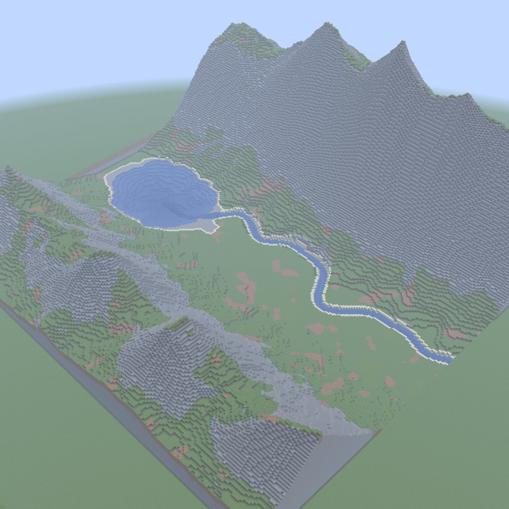
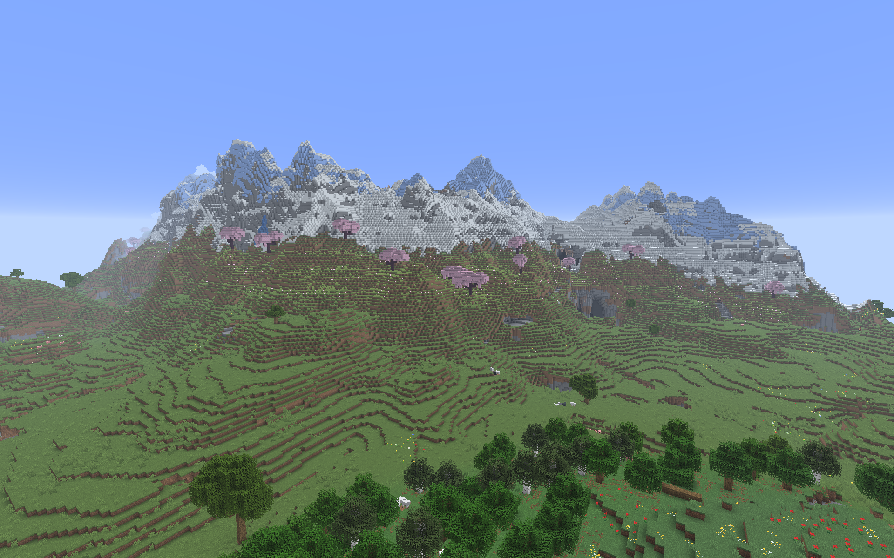
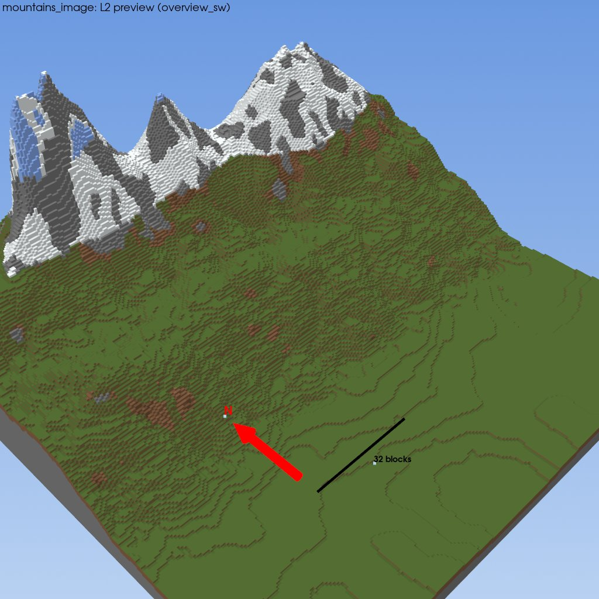
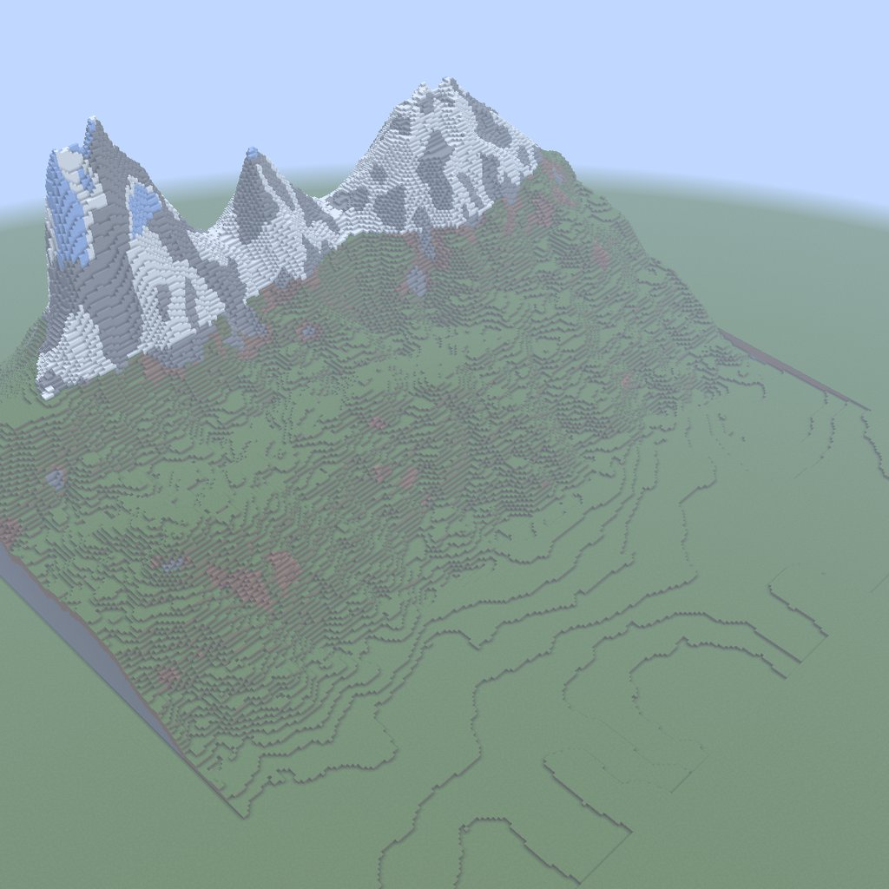
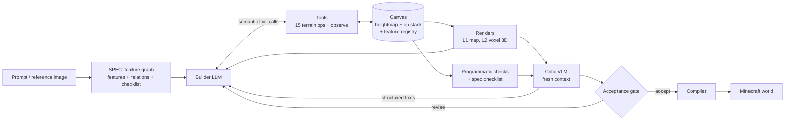
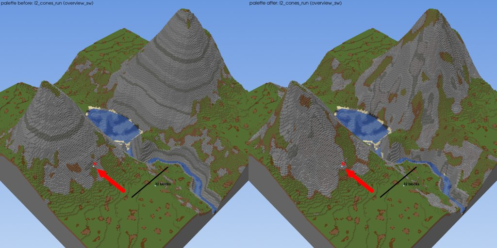
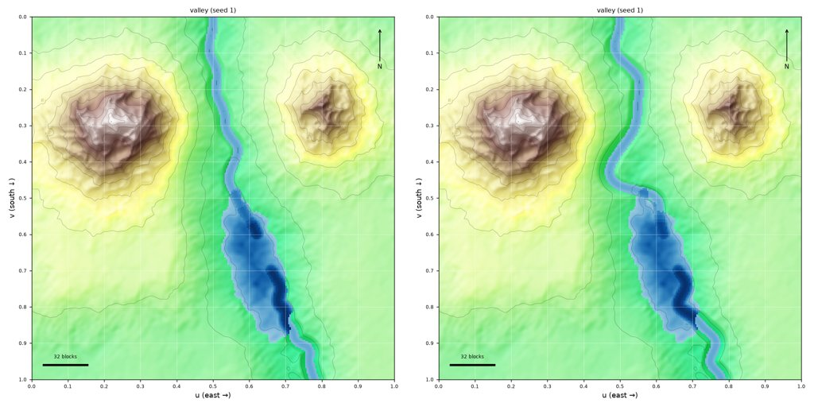

# Terraform Agent

An LLM agent that turns a text prompt or a reference image into large Minecraft terrain: mountains,
valleys, rivers, lakes, mesas. It edits an in-memory terrain canvas through semantic tools, looks at
renders of its own work, gets reviewed by a separate critic, revises, and the result is compiled into a
Minecraft Java world.

The point of the project is the **agent runtime**: the harness, tool design, context management, the
critic and acceptance gate, and an evaluation that measures whether any of it helps.

**The split.** The model owns intent and taste: it reads the prompt or image, plans features (a peak, a
ridge, a river into a lake) and their relations, and calls tools with semantic parameters such as
normalized coordinates, named presets and 0–1 scales. Code owns precision: geometry, physical rules
(rivers only descend, lakes fill to their spill height), measurement, checks and every block placed. The
model never emits blocks, raw grids or Minecraft commands.

## Examples

**Text prompt** (benchmark `t01`, Claude Haiku 5.5 builder, Gemini 3.8 Flash critic; met every success
criterion, judge score 3.3 / 5):

> A wide valley between two mountains, the western one taller. A winding river runs down the valley from
> the north and ends in a lake.

| L2 preview (what the agent sees) | In game |
|---|---|
|  |  |

**Reference image** (benchmark `i05`, Claude Opus 5.5 as builder and critic; the judge passed it, but
the checklist's meadow item failed, so it does not count as a full success):

| Reference | L2 preview | In game |
|---|---|---|
|  |  |  |

Both builds were replayed from their saved op stacks (`docs/showcase/*.json`) and compiled with
`scripts/compile_world.py`.

## How it works



- **Canvas and op stack.** Every edit is an op (`raise_ridge`, `carve_river`, `fill_lake`,
  `set_palette_rules`, ...) with a pydantic parameter model. The model is the validator and the tool schema,
  and its docstring is the tool description. Undo and revision mean editing the stack and replaying it.
  Errors go back to the model as fixable messages, never silently clamped.
- **SPEC.** The prompt or image becomes a feature graph (features, qualitative attributes, relations such
  as "west of" or "flows into") that is pinned for the run. Code measures the built terrain against it, so
  "is there a lake and does the river reach it" is checked, not asked.
- **Critic.** A separate VLM call with a fresh context sees the renders, the measured features and the
  failed checks, and returns structured fixes in the same op vocabulary.
- **Acceptance gate.** Rubric scores are too noisy to gate on, and models favour whatever is framed as the
  revision. So a revision is rolled back if it fails a check the previous attempt passed or loses
  checklist items. Otherwise a blind, order-randomized comparison ("Terrain 1" vs "Terrain 2") decides.
- **Context and cost.** The system prompt and tool list are byte-stable within a run (prompt caching),
  only the latest renders stay in context, and every run has step, cost and time budgets.
- **Compiler and backend.** Heights stay floats on the canvas until the compiler voxelizes them, applies
  the material palette and writes the world through amulet-core. It writes to a copy and swaps it in, and
  keeps a snapshot for undo.
- **Traces.** Every step is a JSONL record. Every tool, prompt, critic or harness change cites the traces
  and renders behind it in [`docs/EVIDENCE.md`](docs/EVIDENCE.md), including reverted experiments.

The full design is in [`docs/DESIGN.md`](docs/DESIGN.md), and the build order in
[`docs/ROADMAP.md`](docs/ROADMAP.md).

### Changes driven by traces

| Palette: banded cliffs → slope-dependent rock patches | River meander recalibrated |
|---|---|
|  |  |

On the left, the rock share on 25–35° slopes went from 2.6% to 16% and on 55–65° slopes from 100% to
78%, which removed the striped cones. On the right, bends now come every ~12 channel widths instead of one
wave across the whole river. Both are in `docs/EVIDENCE.md` (2026-10-22, 2026-10-23).

## Results

A 15-prompt benchmark (10 text, 5 reference images) with hand-written answer-key graphs that are used only
for grading. **Success** = no failed major answer-key item, no failed blocking or major programmatic check,
and a pass from a judge model that is not the critic. Builder Claude Haiku 5.5, critic Gemini 3.8 Flash,
judge Claude Opus 5.5. Full report: [`eval/reports/2026-11-01-m6.md`](eval/reports/2026-11-01-m6.md).

| Experiment | Runs | Result |
|---|---|---|
| **E1: critic on vs off** | 60 (15 prompts × 2 seeds × 2) | Success 17% vs 7% (not significant at this N); checklist pass rate 82% vs 83%; judge mean **+0.25** (95% CI +0.03 to +0.44, critic on higher) |
| **E2: SPEC on vs off** (critic on in both) | 20 paired with E1 | Success 20% vs 30%, judge mean −0.18 (CI −0.34 to −0.03): the pinned spec did **not** help at this N |
| **E3: judge vs a human** | 30 blind items | Pass/fail agreement 73%, κ 0.39, Spearman 0.28. The judge is lenient (mean 2.66 vs 2.16) |
| **Opus on images** | 5 (i01–i05) | Judge passes 4/5 vs Haiku's 1/5 (both Gemini-judged), checklist 84% vs 81%, success 0/5 vs 1/5, at ~$0.97 vs $0.08 per run |
| **Cost** | 80 runs | $5.90 total ($3.73 agent + $2.17 judge) |

What the numbers say: the critic loop improves how builds look to the judge, but not checklist fidelity.
Image prompts have 0% success with Haiku. Some failures are systematic: the volcano on `t02`, the second
ridge on `t04`, and two relations on `t09`. These are listed as follow-ups in the roadmap.

## Limitations

- Small N: two seeds per prompt, and most differences are within noise. The CIs and sign tests are in the
  report.
- The judge was checked against one person's ratings and is lenient. Its pass/fail is part of success, so
  read the success rates with E3 in mind.
- Reference images are the weakest mode. Positions and "behind/in front of" relations from a photo are
  often wrong.
- Heightmap only: no overhangs, caves or arches.
- Only one Minecraft version is supported (Java 26.3, amulet-core 1.9.49).

## Next steps

- A larger SPEC ablation, to tell whether the spec hurts or the effect was noise.
- Fixes for the systematic failures (volcano op, ridge placement, relation checks).
- A judge that uses the whole 1–5 scale, and in-game views for the critic and judge (an L3 capture).
- An MCP server packaging, and a live backend (Paper) for editing a running world.

## Related work

The closest work is LLM agents that build 3D scenes. From **SceneCraft** this project takes a relational
scene graph checked by code. From **3D-GPT**, the LLM choosing parameters for procedural generators. From
**BlenderAlchemy**, comparison-based acceptance with rollback. From **CADCodeVerify**, **TIFA** and
**Davidsonian Scene Graph**, verification questions derived from the request. Unlike Minecraft agents such as
**Voyager**, **Mindcraft** or MCP block servers, it does not act block by block or pick preset generators.
Terrain is a canvas of replayable semantic ops, features are the unit of planning and checking, and the
runtime, critic and evaluation are its own. On the agent side it follows **SWE-agent**'s attention to the
agent–computer interface and Anthropic's notes on building effective agents and tools. The full list with
what was borrowed and what was avoided is in `docs/DESIGN.md` §17.

## Setup

Python 3.12, Minecraft Java Edition 26.3.

```bash
python -m venv .venv
.venv\Scripts\python -m pip install -e ".[dev,render,gemini]"
```

Put `ANTHROPIC_API_KEY` (and optionally `GEMINI_API_KEY`) in `.env`.

```bash
pytest
```

```bash
python -m agent.run --prompt "A wide valley between two mountains with a river ending in a lake"
```

```bash
python -m scripts.compile_world --world "<path to a world save>" --stack docs/showcase/valley_text.json --origin 0 0
```

The world must be closed in Minecraft, and the area's chunks generated. The compiler writes a copy, swaps
it in and keeps a snapshot (`--restore` to undo). Evaluation commands are in `CLAUDE.md` (`eval.run_eval`
and `eval.reproduce`). The paid ones print a cost estimate and spend only with `--yes`, and `pytest` never
calls an API.

## Image credits

- `docs/images/mountains.png`: the author's own in-game screenshot.
- `Glacier_park1.jpg` (benchmark `i01`) by BorisFromStockdale,
  [Wikimedia Commons](https://commons.wikimedia.org/wiki/File:Glacier_park1.jpg), licensed
  [CC BY-SA 3.0](https://creativecommons.org/licenses/by-sa/3.0/). It stays under that license.
- All other images are renders or screenshots of this project's output. Minecraft is a trademark of
  Mojang Studios; this project is not affiliated with it.

## License

Copyright © 2026 Victor. All rights reserved. The code is public to read. No license is granted to use,
copy, modify or distribute it.
